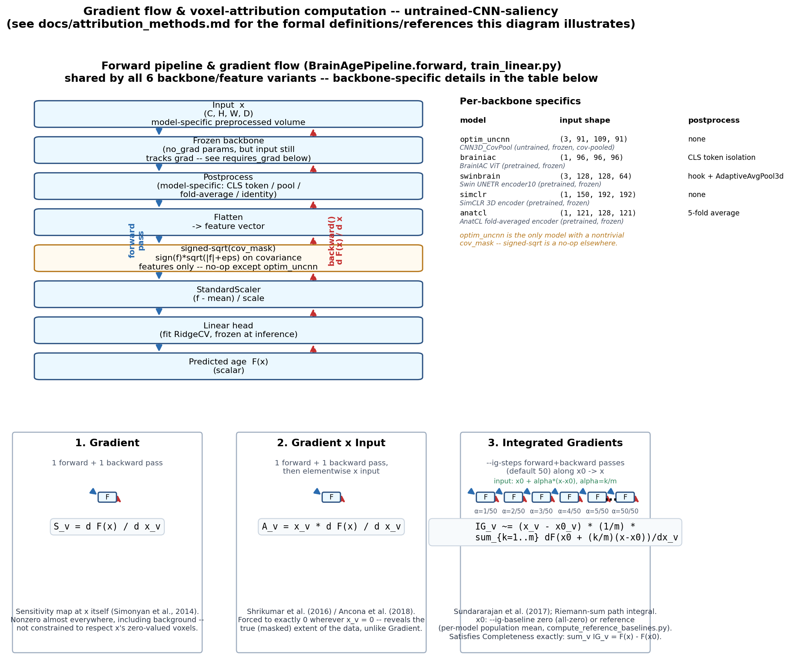

# Attribution methods: formal definitions

Mathematical definitions of the three voxel-attribution methods implemented
in `compute_direct_pipeline_saliency` (`src/calculate_gradcam.py`), selected
via `--attribution-method` (`calculate_gradcam.py`'s CLI). All three are
gradient-based, white-box methods computed by backpropagating through the
full frozen backbone + linear ridge head (`BrainAgePipeline`) in one or more
forward/backward passes -- no architecture-specific hooks (e.g. Grad-CAM's
final-conv-layer assumption) are used, which is what makes them comparable
across the 6 structurally different backbones in this repo (see the
README's "Why vanilla gradient..." note).

## Diagram



Top: the forward/backward pipeline shared by all 6 backbone/feature variants
(`BrainAgePipeline.forward`, `src/train_linear.py`), with per-backbone input
shapes and postprocessing. Bottom: how each method below turns that gradient
into a voxel map -- number of forward/backward passes and the resulting
formula. Regenerate with `python3 src/plot_gradient_flow_diagram.py`
(schematic only -- it doesn't load any checkpoint or run a real pass).

## Notation

- `x in R^(C x H x W x D)`: one subject's preprocessed input tensor, in
  whatever resize/crop/transpose space that model's `Dataset` class
  produces (see `docs/known_limitations.md`'s "Resampling pipeline"
  section for the per-model preprocessing table). `x_v` denotes a single
  voxel/channel entry of `x`.
- `F: R^(C x H x W x D) -> R`: the full pipeline (`BrainAgePipeline.forward`)
  -- frozen backbone, optional postprocessing, signed-sqrt covariance
  normalization, `StandardScaler` affine transform, and the linear `RidgeCV`
  head -- collapsed to the single scalar predicted age `F(x)`.
- `S in R^(C x H x W x D)`: the voxelwise attribution/saliency map returned
  by a given method, same shape as `x`.

When a single MRI `x` is copied into `C` identical model-input channels
(`X_c = x`, as in `swinbrain`), the attribution with respect to the original
MRI is collapsed with the chain-rule **sum** over channels:

```
d F / d x_v = sum_c d F / d X_(c,v)
```

The same sum applies to Gradient x Input and Integrated Gradients. A channel
mean would preserve the spatial pattern after per-map normalization, but
would incorrectly divide attribution magnitudes, ROI totals, and the
Integrated Gradients completeness sum by `C`. `optim_uncnn` is different:
its raw/rank/Sobel channels are heterogeneous representations and remain
separate rather than being collapsed.

## 1. Gradient ("vanilla gradient" / saliency map)

```
S_v = d F(x) / d x_v
```

Implemented as a single forward pass to `F(x)` followed by one
`backward()` call, reading `x.grad` (`compute_direct_pipeline_saliency`,
`attribution_method="gradient"`).

This is the saliency-map method of Simonyan, Vedaldi & Zisserman (2014),
"Deep Inside Convolutional Networks: Visualising Image Classification
Models and Saliency Maps" (ICLR Workshop) -- the local linear approximation
of `F` at `x`, i.e. how much an infinitesimal change in voxel `v` would move
the predicted age. It is a **sensitivity** map, not a **contribution** map:
it says nothing about how far `x_v` actually is from some reference value,
only the local slope at the point `x` itself, so it is generally nonzero
even in background/skull-stripped voxels where `F` still has a nonzero
gradient (see `docs/known_limitations.md`'s "Resampling pipeline" section
for how this makes gradient's coverage misleadingly total compared to the
two methods below).

## 2. Gradient x Input

```
A_v = x_v * d F(x) / d x_v
```

Implemented by computing the same `d F(x) / d x_v` as above and multiplying
elementwise by `x_v` read from the same preprocessed tensor the gradient was
taken with respect to (`attribution_method="gradient_x_input"`), not raw
pre-normalization image intensity.

This is the "Gradient * Input" attribution surveyed in Shrikumar, Greenside,
Shcherbina & Kundaje (2016), "Not Just a Black Box: Learning Important
Features Through Propagating Activation Differences" (arXiv:1605.01713),
and formalized within the broader gradient-based-attribution taxonomy of
Ancona, Ceolini, Öztireli & Gross (2018), "Towards Better Understanding of
Gradient-Based Attribution Methods for Deep Neural Networks" (ICLR).
For a model that is exactly affine in `x`,
`sum_v A_v = F(x) - F(0)` -- it exactly decomposes the non-bias part of the
prediction. `BrainAgePipeline` is nonlinear (signed-sqrt covariance
normalization, and a nonlinear backbone for every model except the linear
head itself), so this decomposition is only a local, first-order
approximation here, not exact -- see `docs/known_limitations.md`.

Because `A_v` is forced to exactly `0` wherever `x_v = 0` (e.g. background
voxels in a zero-padded/skull-stripped preprocessed volume), this method's
maps have genuinely zero-valued regions that vanilla gradient's do not --
which is what first made the resampling-shrinkage bug described in
`docs/known_limitations.md` visible, and is the reason cortical-coverage
questions about this pipeline are diagnosed using `gradient_x_input`/
`integrated_gradients` rather than plain `gradient`.

## 3. Integrated Gradients

```
IG_v(x, x0) = (x_v - x0_v) * integral_{alpha=0}^{1} [ d F(x0 + alpha*(x - x0)) / d x_v ] d alpha
```

Sundararajan, Taly & Yan (2017), "Axiomatic Attribution for Deep Networks"
(ICML, PMLR 70:3319-3328; arXiv:1703.01365). `x0` is a user-chosen
*baseline* input representing "absence of information"; `IG_v` attributes
the difference in prediction `F(x) - F(x0)` to each voxel by integrating the
gradient along the straight-line path from `x0` to `x` in input space.
Unlike the two methods above, the exact Integrated Gradients path integral
satisfies the *Completeness* axiom (for any `x0`, without requiring `F` to be
linear): `sum_v IG_v(x, x0) = F(x) - F(x0)`.

**Riemann-sum approximation.** `_integrated_gradients_and_prediction`
(`src/calculate_gradcam.py`) approximates the path integral with a
left-endpoint-excluded Riemann sum over `--ig-steps` (default 50) equally
spaced points, as recommended in Sundararajan et al. (2017), Section 5:

```
IG_v(x, x0) ~= (x_v - x0_v) * (1/m) * sum_{k=1}^{m} [ d F(x0 + (k/m)*(x - x0)) / d x_v ]
```

with `m = --ig-steps`. Each term requires a separate forward + backward
pass (`m` total, vs. 1 for `gradient`/`gradient_x_input`), so increasing
`--ig-steps` trades runtime for a tighter Riemann approximation of the true
integral. The finite-step approximation does not satisfy completeness
exactly. Each run therefore records the baseline prediction, prediction
difference, attribution sum, signed completeness residual
`F(x) - F(x0) - sum_v IG_v`, and relative absolute residual in its
`*_sanity_checks.json`. These values are computed over all input channels
before channel collapse or spatial resampling. Step-count convergence should
be checked before treating the values as quantitatively decomposed years.

**Baselines (`--ig-baseline`).** Two choices are implemented, both in the
same preprocessed (model-specific) space `x` itself lives in:

- `zero` (`x0 = 0`): the conventional default baseline in the Integrated
  Gradients literature when there is no natural "absence" input -- an
  all-zero image is at least unambiguous, though not necessarily
  anatomically meaningful for a skull-stripped, intensity-normalized brain
  volume where `0` may or may not coincide with "background" depending on
  each model's own normalization.
- `reference` (`x0` = the per-model population-mean preprocessed volume,
  `compute_reference_baselines.py` / `load_reference_baseline`): a
  population-mean baseline, closer in spirit to the "expected/average
  input" baselines discussed as an alternative to zero in the interpretable-
  ML literature for domains (like medical imaging) where an all-zero input
  isn't a meaningful reference point for what the model considers "no
  signal" -- see `docs/known_limitations.md` for the fuller discussion of
  why a population mean is generally better motivated than zero for the
  z-scored/robust-scaled inputs used here. Computed once per model as the
  voxelwise mean of every subject's own preprocessed input tensor (same
  space `x` lives in, not raw pre-normalization intensity), so it is
  directly usable as `x0` without any additional transform.

`optim_uncnn`'s `reference` baseline is the one exception in how it's
*stored* (not in how `IG_v` is computed): its 3 channels (raw/rank/Sobel;
see `docs/known_limitations.md`) are heterogeneous, so their population
means are saved as 3 separate `.npy` files and restacked into one
`(3, H, W, D)` array by `load_reference_baseline` before use as `x0` --
`IG_v` itself is computed identically to every other model, per channel.

## References

- Simonyan, K., Vedaldi, A., & Zisserman, A. (2014). Deep Inside
  Convolutional Networks: Visualising Image Classification Models and
  Saliency Maps. *ICLR Workshop*. arXiv:1312.6034.
- Shrikumar, A., Greenside, P., Shcherbina, A., & Kundaje, A. (2016). Not
  Just a Black Box: Learning Important Features Through Propagating
  Activation Differences. arXiv:1605.01713.
- Sundararajan, M., Taly, A., & Yan, Q. (2017). Axiomatic Attribution for
  Deep Networks. *ICML*, PMLR 70:3319-3328. arXiv:1703.01365.
- Ancona, M., Ceolini, E., Öztireli, C., & Gross, M. (2018). Towards Better
  Understanding of Gradient-Based Attribution Methods for Deep Neural
  Networks. *ICLR*. arXiv:1711.06104.
- Adebayo, J., Gilmer, J., Muelly, M., Goodfellow, I., Hardt, M., & Kim, B.
  (2018). Sanity Checks for Saliency Maps. *NeurIPS*. arXiv:1810.03292.
  (Referenced here because it's the basis for this pipeline's
  `--randomize-model`/`--randomize-data`/`--randomize-input` sanity checks,
  applicable to all 3 attribution methods above -- see
  `docs/known_limitations.md`.)
